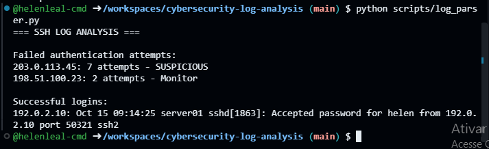

# Cybersecurity Log Analysis

Blue Team / SOC project focused on analyzing SSH authentication logs, identifying suspicious login attempts and documenting an incident investigation.

## Project Objective

The objective of this project is to simulate a basic SOC investigation using authentication logs from a Linux server.

The analysis focuses on:

- Failed SSH authentication attempts
- Repeated login attempts from the same IP address
- Multiple usernames tested by a single source
- Successful authentication events
- Administrative activity after login
- Basic incident classification and mitigation recommendations

## Scenario

A Linux server generated authentication events containing failed and successful SSH login attempts.

The goal was to analyze these logs and determine whether the activity could indicate a brute-force or credential-guessing attack.

All IP addresses and log data used in this project are fictional and were created exclusively for educational purposes.

## Key Findings

The investigation identified:

- 7 failed authentication attempts from `203.0.113.45`
- Attempts against multiple accounts: `admin`, `root` and `test`
- 2 failed authentication attempts from `198.51.100.23`
- 1 successful login from `192.0.2.10`
- Administrative activity using `sudo` after the successful login

The repeated authentication failures from `203.0.113.45` were classified as suspicious and consistent with a possible SSH brute-force or credential-guessing attempt.

## Project Structure

```text
cybersecurity-log-analysis/
├── analysis/
│   └── incident_analysis.md
├── logs/
│   └── sample_logs.txt
├── scripts/
│   └── log_parser.py
└── README.md
```

## Log Analysis Script

The Python script automatically analyzes the authentication log and:

- Extracts source IP addresses
- Counts failed authentication attempts
- Identifies successful logins
- Flags IP addresses with repeated failures
- Classifies suspicious authentication behavior

An IP address is classified as `SUSPICIOUS` when it generates three or more failed authentication attempts.

## How to Run

Clone the repository:

```bash
git clone https://github.com/helenleal-cmd/cybersecurity-log-analysis.git
```

Enter the project directory:

```bash
cd cybersecurity-log-analysis
```

Run the analysis:

```bash
python scripts/log_parser.py
```

## Expected Output

```text
=== SSH LOG ANALYSIS ===

Failed authentication attempts:
203.0.113.45: 7 attempts - SUSPICIOUS
198.51.100.23: 2 attempts - Monitor

Successful logins:
192.0.2.10: Oct 15 09:14:25 server01 sshd[1863]: Accepted password for helen from 192.0.2.10 port 50321 ssh2
```
## Execution Evidence

The following screenshot shows the Python log analysis script running successfully in GitHub Codespaces and identifying suspicious SSH authentication activity.



## Incident Analysis

The source IP `203.0.113.45` generated repeated failed authentication attempts against multiple user accounts within a short period.

This behavior is consistent with a possible brute-force or credential-guessing attempt.

The successful authentication from `192.0.2.10` was analyzed separately. After the login, the user executed an administrative command using `sudo`.

Based only on the available logs, there is no evidence that the suspicious IP successfully authenticated.

A more complete investigation would require additional system, authentication and network logs.

## Incident Response Recommendations

Based on the investigation, the following actions are recommended:

1. Review additional authentication logs for activity from suspicious IP addresses.
2. Monitor or temporarily block sources generating repeated authentication failures.
3. Disable direct SSH login for the root account.
4. Prefer SSH key authentication instead of passwords.
5. Implement rate limiting or tools such as Fail2ban.
6. Monitor successful authentication events following repeated failed attempts.
7. Centralize authentication logs and configure security alerts.

## Skills Demonstrated

- Security log analysis
- Blue Team fundamentals
- SOC investigation workflow
- SSH authentication analysis
- Incident identification
- Basic threat detection
- Python log parsing
- Regular expressions
- Incident documentation
- Security recommendations

## Technologies

- Python
- Linux authentication logs
- SSH
- Git
- GitHub
- Markdown

## Disclaimer

This project was created for educational and portfolio purposes.

All logs, users, IP addresses and security events are fictional and do not represent real systems or incidents.
